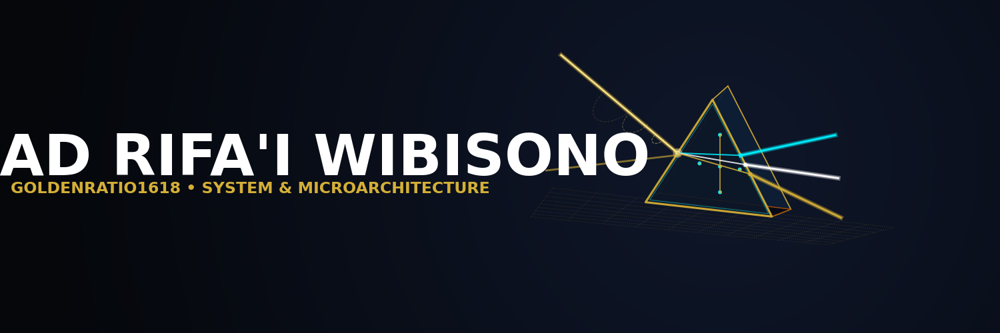

  

# Ahmad Rifa'i Wibisono (`Goldcode1618`)

**Electrical Engineering Researcher & System Architect — Universitas Muhammadiyah Prof. DR. HAMKA (UHAMKA)**  
Lead Architect of the **PRISM** (*Prototype, Research and Integration of System & Microarchitecture*) and **ARES** (*Autonomous Robotic & Quantitative Edge System*) ecosystems.

---

### Active Open-Science & Hardware Repositories

| Repository | Domain | Focus |
| :--- | :--- | :--- |
| [**`amd-heterogeneous-ai-lab`**](https://github.com/Goldcode1618/amd-heterogeneous-ai-lab) | Heterogeneous AI / AMD ROCm & XDNA | Unified Edge-to-Cloud AI Acceleration: XDNA 1 NPU (`Ryzen AI 1.9.0`), RDNA 3 DirectML, Token Lab API & Instinct MI300X Benchmarks + 26-Course AMD AI Academy & ROCm Labs (Apache-2.0) |
| [**`pydantic-ai-multi-mcp-agent`**](https://github.com/Goldcode1618/pydantic-ai-multi-mcp-agent) | Agentic AI / Model Context Protocol | Standalone ReAct AI Agent (`PydanticAI`) orchestrating M=3 MCP Servers (`Time`, `Weather`, `Airbnb`) over AMD Token Lab, ROCm `vLLM`, Ollama & LM Studio (Apache-2.0) |
| [**`ares-rx-sentinel`**](https://github.com/Goldcode1618/ares-rx-sentinel) | ASIC / Hardware Security | SkyWater 130nm (`sky130_fd_sc_hd`) Trusted Digital Reception Boundary for Tiny Tapeout TT08 (forked from [`ARES-1618/ares-rx-sentinel`](https://github.com/ARES-1618/ares-rx-sentinel)) |
| [**`Smartwall-WPT-Simulation`**](https://github.com/Goldcode1618/Smartwall-WPT-Simulation) | Electromagnetics / WPT | Coupled-Mode Theory, Phase-Conjugate RIS Beamforming & 9,000-trial Monte Carlo simulation (Apache-2.0) |
| [**`prism-safety-gps`**](https://github.com/Goldcode1618/prism-safety-gps) | Embedded / KiCad / CAD | Compact impact-sensing & real-time BLE-to-Cloud GNSS tracker (ESP32-C3, WireViz, KiCad, STEP) |
| [**`bco-contingency`**](https://github.com/Goldcode1618/bco-contingency) | Embedded / Power Resilience | Blackout Contingency Orchestrator v1.1 (ESP32-C3 pre-diode power-loss sentinel + Office COM rescue) |
| [**`prism-powerlink`**](https://github.com/Goldcode1618/prism-powerlink) | Power Electronics / BMS | Smart Auto-Cutoff Li-Ion Degradation Stopper v1.0 (ESP32-C3 + INA226 + D4184) |

---

### Core Stack & Tooling
- **Hardware & EDA:** Verilog RTL, Tiny Tapeout (OpenLane / SkyWater 130nm), KiCad, WireViz, SolidWorks (`.step`/`.dxf`), ESP32-C3
- **Systems & Security:** Python, PowerShell, FastAPI, PyQt6, `sing-box`, Tor, Named-Pipe IPC
- **Compute & ML:** AMD Ryzen AI 1.9.0 (XDNA 1 NPU / VitisAI EP), ONNX Runtime 1.30.0, DirectML (RDNA 3), ROCm / HIP C++ / Instinct MI300X, `vLLM`, PydanticAI, Model Context Protocol (MCP), PyTorch, CatBoost, LightGBM, CUDA, Google Colab Pro A100 Offload

---

- **Contact:** `2503025001@uhamka.ac.id`
- **License Default:** Apache License 2.0 (Open Science & Hardware Research)
